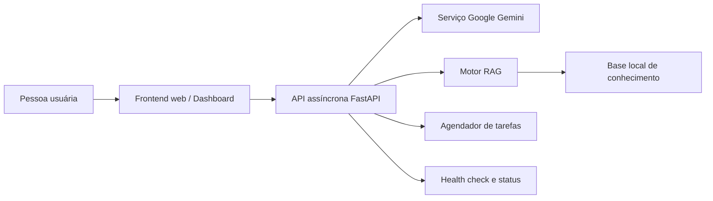

# Império Mutante

<p align="center">
  <strong>Plataforma experimental de inteligência e automação com IA generativa e busca contextual em documentos.</strong>
</p>

<p align="center">
  
  
  
  
  
</p>

> Projeto pessoal em desenvolvimento. Esta documentação descreve os componentes presentes no repositório; funcionalidades, integrações e implantação devem ser validadas no ambiente antes de uso em produção.

## Visão geral

O **Império Mutante** combina uma API assíncrona em FastAPI, integração com Google Gemini e interfaces web para experimentar geração de conteúdo, consulta conversacional com recuperação de contexto (RAG) e gestão de uma base de conhecimento.

A API também registra rotas para prompts, scraping, ingestão em lote, swarm e módulos de monetização/cobrança. A disponibilidade e configuração dessas integrações dependem do ambiente.

## Visão da interface

A imagem abaixo é um **mockup ilustrativo**, não uma captura de tela da aplicação. Ela representa as áreas que aparecem no dashboard estático do repositório.

<p align="center">
  
</p>

## Funcionalidades em destaque

- **Geração com Gemini:** endpoint assíncrono para gerar conteúdo a partir de prompts e instruções de sistema.
- **Chat com RAG:** busca contexto na base local de conhecimento, envia a pergunta ao modelo e retorna as fontes encontradas.
- **Resposta em streaming:** rota de chat que transmite eventos em tempo real usando Server-Sent Events (SSE).
- **Base de conhecimento:** rotas para consultar e ingerir documentos; o dashboard apresenta itens indexados e permite solicitar nova ingestão.
- **Estúdio de prompts:** listar e salvar templates de prompt e instruções de sistema.
- **Observabilidade de respostas:** o chat pode devolver fontes, modelo utilizado, latência e dados de telemetria disponíveis.
- **Execução conteinerizada:** Dockerfiles separados para API e frontend e orquestração com Docker Compose.
- **Verificação de saúde e agendador:** endpoints de health check e status do agendador de tarefas.

## Tecnologias

| Camada | Tecnologias |
| --- | --- |
| API | Python 3.11, FastAPI, Uvicorn, Pydantic |
| IA generativa | Google Gen AI SDK (Gemini) |
| Interface Next.js | Next.js, React, TypeScript, Tailwind CSS |
| Dashboard estático | HTML, JavaScript e Tailwind CSS via CDN |
| Infraestrutura | Docker, Docker Compose |

## Arquitetura



A API registra os módulos de geração, chat, RAG, conhecimento, prompts, scraping, swarm, ingestão em lote, monetização e cobrança. O dashboard estático em `interface_dashboard/` é servido pela API em `/dashboard/` quando o diretório está disponível. O serviço Next.js é executado separadamente pelo Docker Compose.

## Casos de uso

- Fazer perguntas sobre documentos próprios e receber respostas contextualizadas com referências às fontes recuperadas.
- Testar prompts e instruções de sistema com o modelo Gemini.
- Indexar documentos de conhecimento para consultas posteriores.
- Integrar geração de texto ou chat a outro cliente por meio da API HTTP.
- Explorar respostas em streaming e os dados de telemetria expostos pela API.

## Começar

### Requisitos

- Docker e Docker Compose; **ou** Python 3.11+ e Node.js 20+ para execução local.
- Uma chave da API Gemini para os recursos que chamam o modelo.

### Configurar credenciais

Crie um arquivo `.env` na raiz do projeto:

```env
GEMINI_API_KEY=sua_chave_gemini
DEFAULT_GEMINI_MODEL=gemini-2.5-flash
API_PORT=8000
FRONTEND_PORT=3000
```

Não compartilhe nem versione chaves, tokens ou outras credenciais.

### Executar com Docker Compose

Na raiz do repositório:

```bash
docker compose up --build
```

Endereços locais:

- Frontend Next.js: http://localhost:3000
- API: http://localhost:8000
- Dashboard estático: http://localhost:8000/dashboard/
- Documentação interativa: http://localhost:8000/docs
- Health check: http://localhost:8000/health

Para encerrar:

```bash
docker compose down
```

### Executar em desenvolvimento

Instale as dependências da API em um ambiente virtual:

```bash
python -m venv .venv
```

Linux/macOS:

```bash
source .venv/bin/activate
```

Windows PowerShell:

```powershell
.venv\Scripts\Activate.ps1
```

Depois, na raiz do projeto:

```bash
pip install -r requirements.txt
uvicorn api_mutante.main:app --reload --host 0.0.0.0 --port 8000
```

Em outro terminal, inicie o frontend:

```bash
cd frontend
npm ci
npm run dev
```

## API

A documentação OpenAPI gerada pelo FastAPI está disponível em `/docs` quando a API estiver rodando. Alguns caminhos principais registrados no código:

| Método | Caminho | Descrição |
| --- | --- | --- |
| `GET` | `/health` | Verifica a saúde da API |
| `POST` | `/v1/generate` | Gera conteúdo com o Gemini |
| `POST` | `/v1/chat` | Chat com recuperação de contexto |
| `POST` | `/v1/chat/stream` | Chat em streaming via SSE |
| `GET` | `/v1/scheduler/status` | Consulta o estado do agendador |

Exemplo de requisição de geração:

```bash
curl -X POST http://localhost:8000/v1/generate \
  -H 'Content-Type: application/json' \
  -d '{"prompt":"Explique o que é RAG em uma frase."}'
```

Exemplo de requisição de chat:

```bash
curl -X POST http://localhost:8000/v1/chat \
  -H 'Content-Type: application/json' \
  -d '{"message":"O que há na base de conhecimento?","top_k":2}'
```

Os campos aceitos e as demais rotas podem mudar; confira `/docs` na versão que estiver executando.

## Estrutura do repositório

```text
.
├── api_mutante/          # API, serviços, rotas e lógica de conhecimento
├── frontend/             # Aplicação Next.js
├── interface_dashboard/  # Dashboard HTML servido pela API
├── scripts_brutos/       # Scripts auxiliares
├── docs/                 # Documentação e recursos visuais
├── main.py               # Exemplo de chamada assíncrona ao Gemini
├── Dockerfile            # Imagem da API
└── docker-compose.yml    # API e frontend
```

## Roadmap sugerido

Itens abaixo são **ideias de evolução**, não compromissos ou funcionalidades já disponíveis:

- [ ] Adicionar capturas reais de tela e uma demonstração curta do fluxo principal.
- [ ] Documentar formatos de arquivo aceitos, limites e comportamento da ingestão de documentos.
- [ ] Criar testes automatizados para rotas críticas e fluxos de RAG.
- [ ] Adicionar exemplos de configuração e implantação para diferentes ambientes.
- [ ] Revisar autenticação, permissões e configuração de CORS antes de qualquer implantação pública.
- [ ] Documentar custos, limites e configuração segura das chamadas ao Gemini.

## Segurança

- Mantenha `GEMINI_API_KEY` e outros segredos somente em variáveis de ambiente ou em um gerenciador de segredos.
- Antes de expor a aplicação à internet, revise autenticação, CORS, limites de uso e armazenamento de documentos. A configuração atual da API permite origens CORS amplas; não a considere pronta para produção sem uma revisão.
- Não envie documentos confidenciais a serviços externos sem avaliar as políticas e permissões aplicáveis.

## Licença

Não foi identificada uma licença no repositório. Até que uma licença seja adicionada, peça autorização ao proprietário antes de reutilizar, modificar ou distribuir o código.
