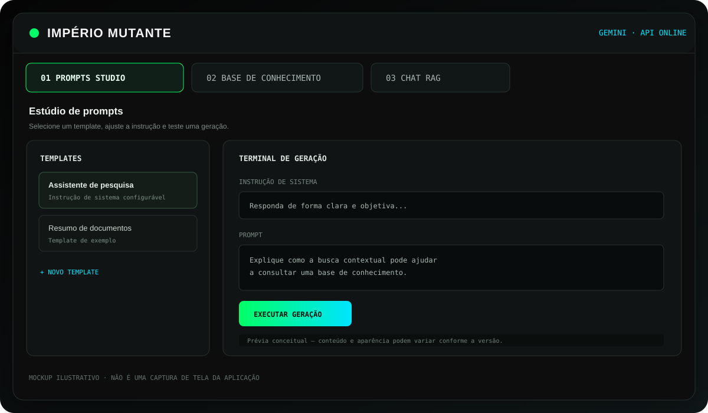
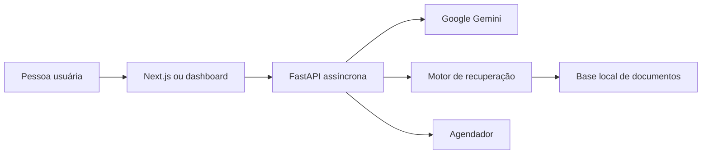

# Império Mutante

<p align="center">
  <strong>AI Product Engineer · Full Stack + AI</strong><br>
  Aplicação full-stack que transforma documentos e prompts em fluxos de consulta e geração assistidos por IA.
</p>

<p align="center">
  
  
  
  
  
</p>

## Produto em uma frase

O **Império Mutante** conecta uma interface web, uma API assíncrona e modelos Gemini para ajudar pessoas a organizar conhecimento, consultar documentos em linguagem natural e testar fluxos de geração em um só lugar.

## Problema e abordagem

Encontrar informação útil em documentos e repetir tarefas de geração com prompts soltos pode consumir tempo e dificultar a consistência. Este projeto explora um fluxo integrado: ingerir conhecimento, recuperar contexto relevante, gerar respostas com IA e apresentar as fontes disponíveis para apoiar a revisão humana.

O repositório demonstra competências de produto e engenharia full-stack — integração de IA por API, experiência web, desenho de endpoints, streaming e empacotamento dos serviços. Não são feitas alegações de resultados comerciais, métricas de produtividade ou uso em produção.

## Experiência principal

1. Adicione ou ingira documentos para a base de conhecimento.
2. Consulte os materiais por meio do chat com recuperação de contexto (RAG).
3. Revise as fontes retornadas junto com a resposta gerada.
4. Teste geração de conteúdo com prompts e instruções de sistema.
5. Integre os fluxos a outros clientes usando os endpoints HTTP documentados.

## Visão da interface

O recurso abaixo é um **mockup ilustrativo**, não uma captura de tela da aplicação. Para avaliar o comportamento real, execute o projeto seguindo as instruções desta página.

<p align="center">
  
</p>

## Capacidades implementadas

- **Geração de conteúdo com Gemini:** endpoint assíncrono que aceita prompt, modelo e instrução de sistema.
- **Chat com RAG:** recupera contexto da base local e inclui as fontes encontradas na resposta.
- **Streaming de chat:** envia eventos de resposta via Server-Sent Events (SSE).
- **Gestão de conhecimento:** rotas para consultar documentos e solicitar ingestão.
- **Gestão de prompts:** listar e salvar templates com instruções de sistema.
- **Telemetria de resposta:** expõe dados de latência, modelo, tokens e custos estimados quando disponíveis.
- **Execução conteinerizada:** serviços da API e do frontend definidos para execução via Docker Compose.
- **Operação básica:** health check e endpoint de status do agendador.

A API também registra módulos de scraping, swarm, ingestão em lote, monetização e cobrança. Configuração, integrações externas e adequação desses módulos devem ser verificadas antes de utilizá-los.

## Engenharia e arquitetura



A API FastAPI centraliza as rotas e serviços de aplicação. O motor RAG busca contexto na base local antes da geração; o frontend Next.js e o dashboard estático oferecem interfaces para os fluxos. Docker Compose coordena API e frontend no ambiente local.

### Stack

| Camada | Tecnologias |
| --- | --- |
| Backend | Python 3.11, FastAPI, Uvicorn, Pydantic |
| Integração de IA | Google Gen AI SDK (Gemini) |
| Frontend | Next.js, React, TypeScript, Tailwind CSS |
| Dashboard | HTML, JavaScript, Tailwind CSS via CDN |
| Execução | Docker, Docker Compose |

## API

Com a aplicação em execução, a documentação OpenAPI está disponível em `http://localhost:8000/docs`. Principais caminhos registrados no código:

| Método | Caminho | Uso |
| --- | --- | --- |
| `GET` | `/health` | Verificar disponibilidade da API |
| `POST` | `/v1/generate` | Gerar conteúdo com Gemini |
| `POST` | `/v1/chat` | Consultar o chat com recuperação de contexto |
| `POST` | `/v1/chat/stream` | Receber eventos de chat via SSE |
| `GET` | `/v1/scheduler/status` | Consultar o estado do agendador |

Os caminhos e modelos de requisição podem mudar; consulte `/docs` na versão que estiver executando.

## Executar localmente

### Requisitos

- Docker e Docker Compose; **ou** Python 3.11+ e Node.js 20+.
- Chave da API Gemini para fluxos que chamam o modelo.

### Configurar ambiente

Crie `.env` na raiz do projeto:

```env
GEMINI_API_KEY=sua_chave_gemini
DEFAULT_GEMINI_MODEL=gemini-2.5-flash
API_PORT=8000
FRONTEND_PORT=3000
```

Mantenha credenciais fora do código, dos commits e de qualquer material público.

### Com Docker Compose

```bash
docker compose up --build
```

- Frontend Next.js: http://localhost:3000
- API: http://localhost:8000
- Dashboard estático: http://localhost:8000/dashboard/
- Documentação da API: http://localhost:8000/docs
- Health check: http://localhost:8000/health

Para encerrar os serviços:

```bash
docker compose down
```

### Desenvolvimento sem Docker

Crie e ative um ambiente Python:

```bash
python -m venv .venv
```

Linux/macOS:

```bash
source .venv/bin/activate
```

Windows PowerShell:

```powershell
.venv\Scripts\Activate.ps1
```

Instale as dependências e inicie a API na raiz:

```bash
pip install -r requirements.txt
uvicorn api_mutante.main:app --reload --host 0.0.0.0 --port 8000
```

Em outro terminal, inicie o frontend:

```bash
cd frontend
npm ci
npm run dev
```

## Estrutura do repositório

```text
.
├── api_mutante/          # API, serviços, rotas e recuperação de conhecimento
├── frontend/             # Aplicação Next.js
├── interface_dashboard/  # Dashboard HTML servido pela API
├── scripts_brutos/       # Scripts auxiliares
├── docs/                 # Documentação e mockup ilustrativo
├── main.py               # Exemplo de chamada assíncrona ao Gemini
├── Dockerfile            # Imagem da API
└── docker-compose.yml    # API e frontend
```

## Próximas melhorias

Estas são oportunidades de evolução, não funcionalidades prometidas:

- [ ] Capturas reais de tela e demonstração do fluxo principal.
- [ ] Testes automatizados para rotas, ingestão e recuperação RAG.
- [ ] Documentação dos formatos de arquivo e limites de ingestão.
- [ ] Configuração mais restrita de CORS e revisão de autenticação e permissões.
- [ ] Métricas e avaliação da qualidade das respostas e da recuperação.
- [ ] Guia de implantação, custos e limites de uso do provedor de IA.

## Segurança e limitações

- Armazene chaves em variáveis de ambiente ou em um gerenciador de segredos; nunca as versione.
- Antes de expor a aplicação à internet, revise autenticação, autorização, CORS, limites de uso e tratamento de documentos. A API atual usa configuração ampla de CORS e não deve ser considerada pronta para produção sem revisão.
- Avalie privacidade e permissões antes de enviar documentos a serviços externos de IA.
- Este repositório não declara métricas de impacto ou resultados de clientes. Valide o comportamento e as dependências no seu ambiente.

## Licença

Não foi identificada uma licença no repositório. Até que uma licença seja adicionada, solicite autorização ao proprietário antes de reutilizar, modificar ou distribuir o código.
